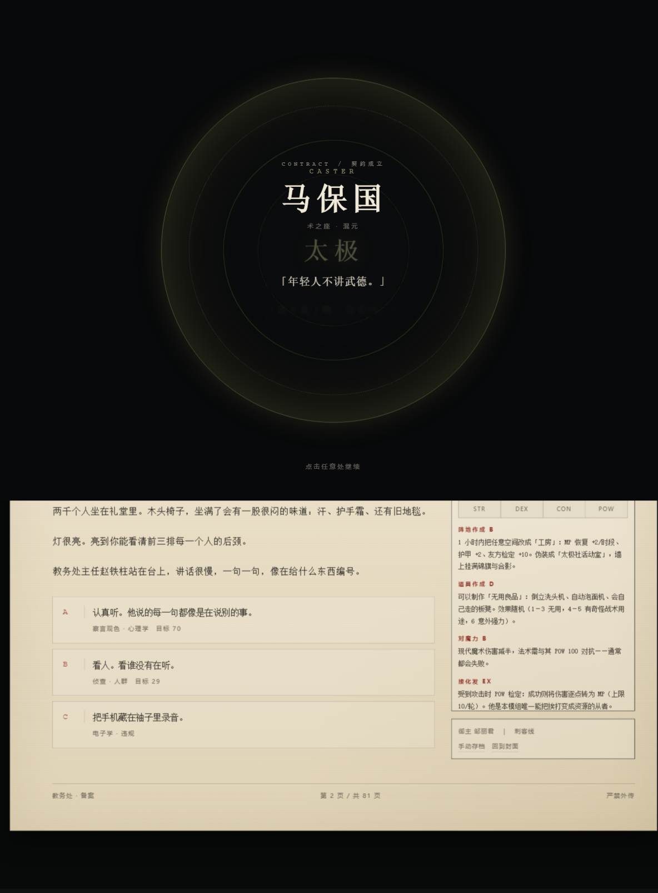
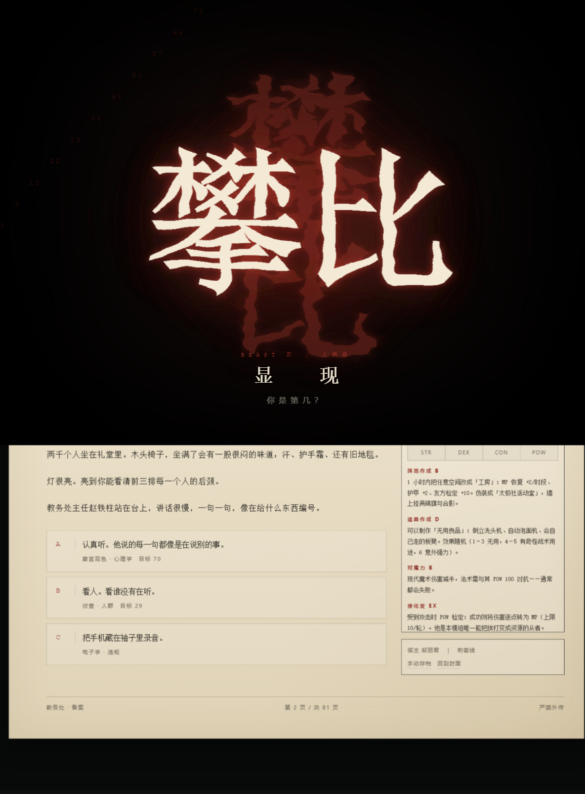
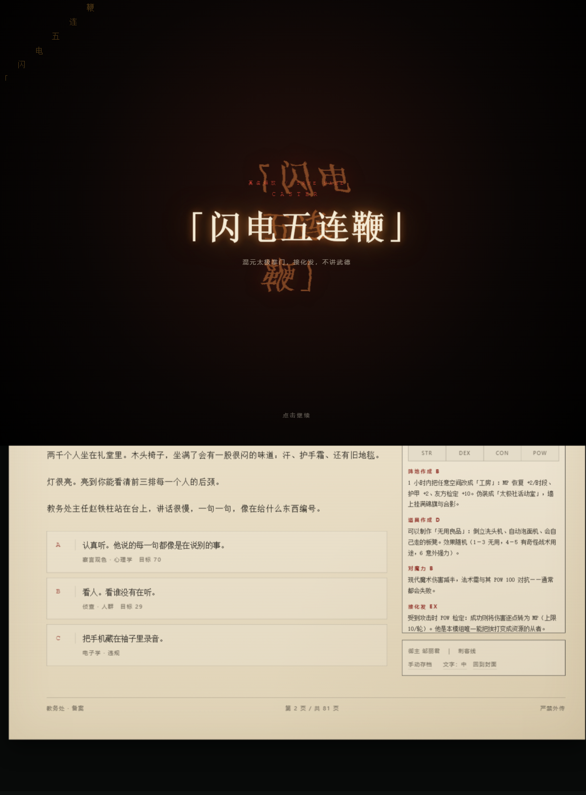
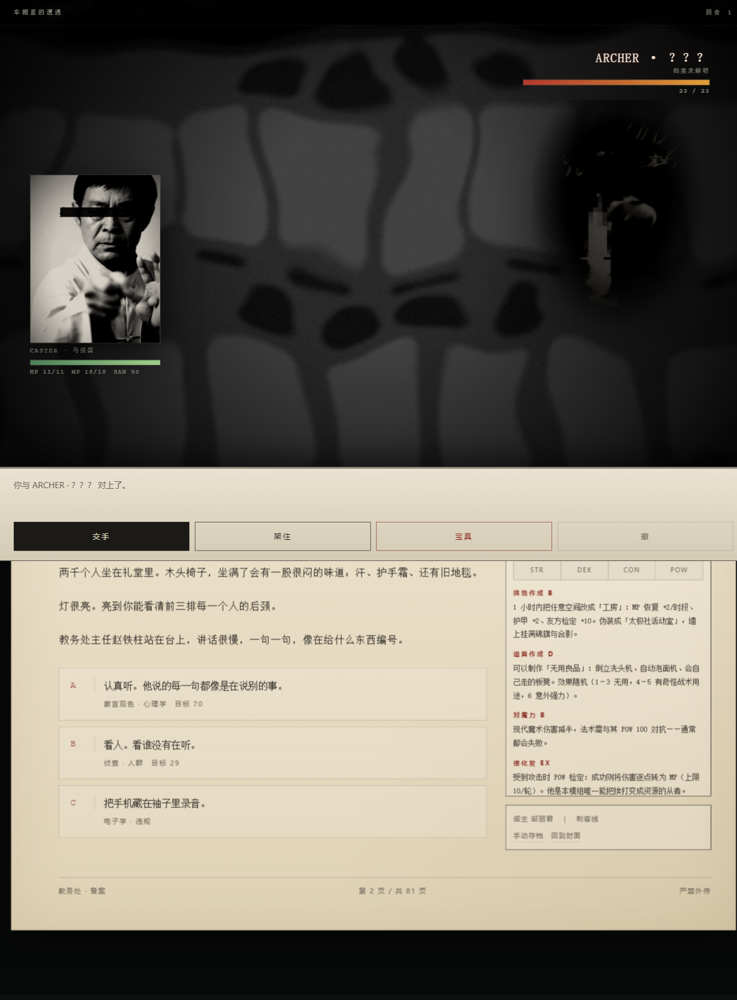
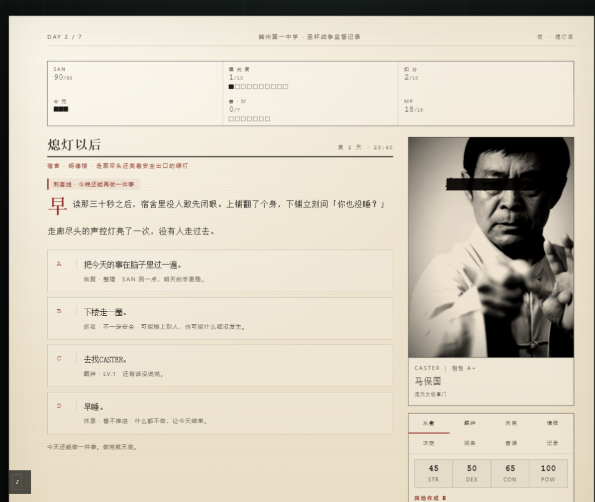
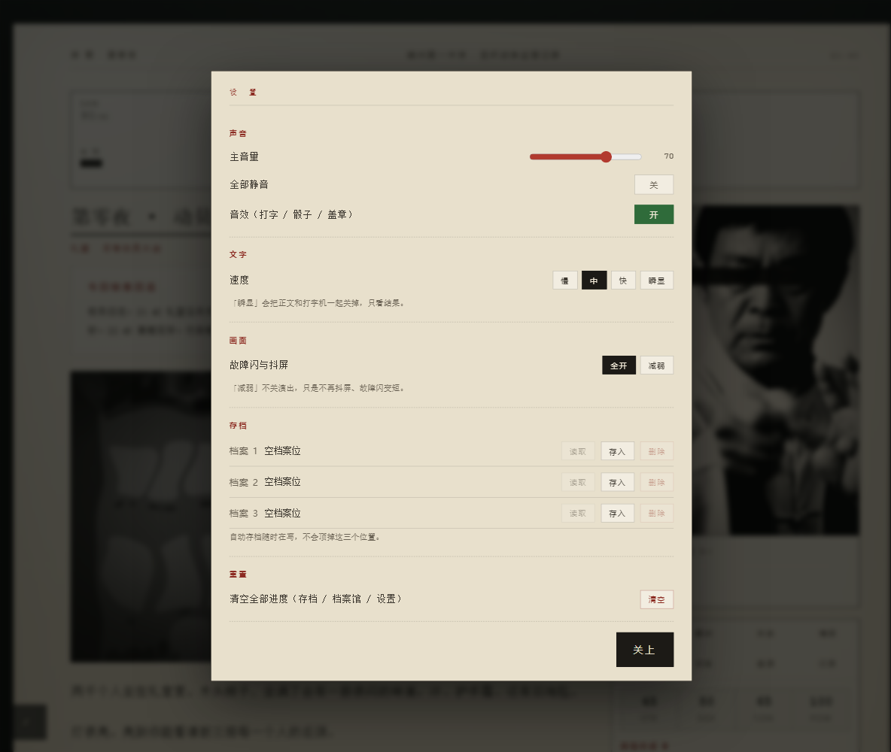
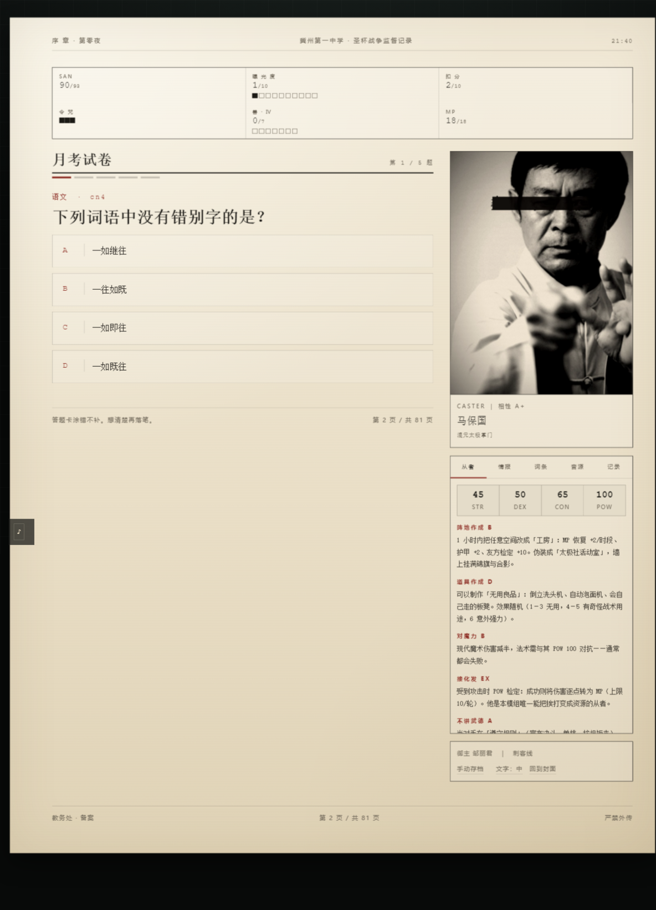

# 圣杯战争 · 衡水：凌晨四点的圣杯

我把《圣杯战争·衡水：凌晨四点的圣杯》——那个 COC 7th 的非官方同人模组——做成了一个双击就能打开的单页网页游戏。

我不想把它做成跑团工具。我想做的是一件事：让一个人坐下来，用一小时左右，把模组里那七天自己过一遍。所以美术走的是档案、公文、扫描件那一路，演出按 AVG 来，日程和数值按 SLG 来。

> **在线试玩**：[qingyu107.github.io/grail-war-hengshui](https://qingyu107.github.io/grail-war-hengshui/)
> **本地跑**：双击 `index.html`。不用服务器、不联网、不依赖框架。

我做进去的东西：

- 档案 / 公文 / 扫描件的美术方向，AVG 式演出
- 每天一次自由行动（校园地图选地点）+ 三条主线时段 + 一段夜间行动
- 回合制战斗：交手 / 架住 / 读招 / 宝具 / 撤，有预兆也有破绽，宝具与专属 BGM 同一帧起
- 羁绊 LV.1–3：三段主线 + 两段加演，等级直接进战斗（伤害 / 减伤 / 判定 / 替身）和结局
- 从者没解明之前只有剪影和故障态，情报到 Ⅲ 才看得到真名
- 11 个结局，三格存档，通关后开放档案馆
- 设置页：音量 / 静音（连音效一起静）/ 文字速度 / 动效减弱 / 存档管理 / 清空进度
- 关系档案：谁还在、谁退场了、谁的真名你已经知道
- 键盘能玩：`1–9` 选选项、`Enter` 继续、`Esc` 关弹层

## 截图

| 召唤仪式 | 人类恶 · 显现 |
| --- | --- |
|  |  |

| 真名解放 | 围殴兽 |
| --- | --- |
|  |  |

| 校园地图 | 回合制战斗 |
| --- | --- |
|  |  |

| 夜间行动 | 设置页 |
| --- | --- |
|  |  |

| 情报：剪影与凝实 | 月考试卷 |
| --- | --- |
|  |  |

---

## 怎么跑

双击 `index.html`。不需要服务器、不需要联网、不依赖框架或 CDN。

- 封面 → 拆封档案 → 九道登记题 → 相性判定 → 序章 → Day 1–7 → 结局。
- 存档写在浏览器 `localStorage`（键 `grail_hengshui_save_v1`），封面「继续上次」接着上次的时段。
- 手机：同一份文件即可，侧栏收成底部抽屉，HUD 变两列，按钮 ≥44px。

> 如果点了没反应：先确认打开的是 `grail-war/index.html` 本身（不是上层文件夹）。
> 页面底部出现红色报错条时，把那行文字发我，按行号能直接定位。

---

## 一局里有什么

| 环节 | 内容 |
| --- | --- |
| 登记表 | **9 道题**，每题 4 个选项；同时给从者相性 / 职介线 / 御主气质 / 属性打分 |
| 分配 | 从者按相性取最高；御主卡取最接近的预设，再用你填的四问覆盖 |
| 相性 | 命中 3 个关键词 A+／2 个 A／1 个 C／0 个 E（错位召唤，带暴走） |
| 职介线 | 情报商 / 刺客 / 合作派 / 规则派 / 流量派，各有专属行动与开局加成 |
| 羁绊支线 | **每骑 3 段主线 + 2 段加演**，共 45 个场景 |
| 共通线 | 每天开头一次点名 + 一段公共叙事；每个时段有收束段与加厚句；Day2/4/6 各一段插叙 |
| 流程 | 序章 + 7 天，约 37 个落笔点（时段 + 自由行动 + 夜晚）；每个时段一次行动 |
| 文本 | 全量约 **3.7 万字**（含所有分支），单局实际读到约 **1.5 万字** |
| 检定 | COC 7 版 d100；失败可烧一划令咒重掷（SAN −1D3） |
| 演出 | 打字机、场景推镜、闪白、抖动、故障字、**「人类恶 · 显现」全屏卡** |
| 情报演出 | 未解明的从者是**纯黑剪影**；情报 Ⅰ→Ⅴ 逐级去噪变实，Ⅲ 出真名、Ⅳ 出弱点、Ⅴ 出宝具 |
| 结局 | 11 个，按模组 9.0 顺序判定 |

数值照模组：SAN = POW、MP = POW÷5、曝光 0–10、扣分满 10 开家长会、兽的 7 格每夜涨一格——
但当天你踩过刹车（改写倒数牌 / 关账号 / 拒绝名次 / 请人背锅），这一夜就不涨。

---

## 目录

```
index.html                 入口
assets/css/archive.css     档案纸 UI（纸张纹理、扫描线、红章、装订孔、响应式）
assets/css/avg.css         AVG 演出层（推镜、打字机、闪白、故障闪、兽卡）
assets/img/                9 人物 + 18 场景（900×1200 / 1200×675）
assets/img/sil/            每位从者的两套「未解明」素材：_warp（扭曲）/ _sil（剪影）
assets/img/glitch/         18 张场景的故障版 + 2 张可叠加的故障纹理
assets/audio/              9 首真人 BGM（mp3，60s 循环）
js/audio.js                WebAudio 播放器（真音源优先，失败回落合成音）
js/avg.js                  打字机、关键节点特效卡、故障闪 glitchBurst
js/engine.js               状态机、相性分配、检定、结算、存档
js/ui.js                   渲染与流程
js/data/roster.js          九骑从者 + 九张御主预设 + 五条职介线
js/data/quiz.js            九道登记题
js/data/story_prologue.js  序章
js/data/story_a.js         Day 1–4
js/data/story_b.js         Day 5–7 + 许愿
js/data/bonds.js           九骑专属羁绊支线（27 段）
js/data/codex.js           词条 / NPC 台词 / 11 篇后日谈
js/data/endings.js         11 个结局与判定
tools/                     提取、抓图、图片处理、故障素材、无头自测脚本（不属于游戏本体）
```

自测：

```
node tools/smoke.js            数据完整性 + 11 个结局判定
node tools/careful.js          四种策略模拟通关
node tools/cdp.js flow         无头浏览器跑完整流程（封面 → 九题 → 相性 → 正片）
node tools/cdp.js long         一路点到结局，检查有没有卡点
node tools/cdp.js mobile       390×844 手机端截图与横向溢出检查
node tools/cdp.js audio5       验证 BGM 真的载入并播放（挂 Audio 钩子）
node tools/cdp.js audio2       九首 mp3 逐个探测能否解码
node tools/sil_assets.py       重新生成剪影 / 扭曲素材
node tools/glitch_assets.py    重新生成故障版场景图与纹理
```

---

## 未解明的从者：剪影 → 扭曲 → 凝实

剧情线里同时只有一名从者（你的），其余七骑在解明之前不给你看脸。情报分五档：

| 等级 | 含义 | 看到的 |
| --- | --- | --- |
| Ⅰ | 传闻 | 故障扭曲态：一团在动的影，认不出是谁 |
| Ⅱ | 外观 | 剪影：轮廓开始成形，但仍在雾里 |
| Ⅲ | 真名 | 原图 + 灰阶与轻模糊，名字解锁 |
| Ⅳ | 弱点 | 原图，几乎清晰 |
| Ⅴ | 宝具 | 原图 |

- 档案夹「情报」页是 8 张卡片，按档位换素材，右上角标当前等级。
- 每次拿到情报，正文下方会插一张「目击记录」：小尺寸剪影 + 职阶 + 等级，并播一次凝实动画。
- 你自己的从者永远按 Ⅴ 显示。
- 素材由 `tools/sil_assets.py` 生成：亮度暗部 × 中心雾底 × 高频轮廓合成 alpha，再压成硬边剪影；
  扭曲态额外做位移场、重影、glitch 条带和局部马赛克。

## 故障艺术

- `assets/img/glitch/scene_*_glitch.jpg`：每张场景的故障版（RGB 通道错位 + 水平撕裂 + 块状马赛克 + 扫描线）。
- `assets/img/glitch/tex_noise_*.png`：透明故障纹理，可叠在任何层上。
- `GrailAVG.glitchBurst(sceneKey, {dur, hard})`：一次 0.3–0.9 秒的全屏故障闪，不挡点击，正文会轻微错位一下。
- 触发时机：高风险时段（曝光 ≥6 / 兽 ≥5、广播夜、决战夜）概率触发；曝光一次涨 2 点以上或兽涨一格时必触发；
  结局前放一次 `hard` 版，把档案撕开。

### 四种整屏演出

| 名称 | 画面 | 用在哪 |
| --- | --- | --- |
| `dissolve` | 一段话逐字显形，然后整体下沉发虚 | 决战前的回顾、结案 |
| `static` | 雪花噪点 + 扫描线 + 四边渗红 | 认不出画面的时候（E2/E3 结局、幻觉） |
| `mirror` | 同一句话左右两份，右边是反的，中间一条红线 | 走廊正在变成一张表（Day6） |
| `bleed` | 红色从四边往里渗，中间空着 | 门开的那一眼（E7） |

`node tools/cdp.js shot "…#dev=fx&k=mirror" out.png` 可以直接看单张。

### SAN 分档：精神掉下去，画面先知道

| 档 | 名字 | 判定 | 交手伤害 | 挨打 | 画面 |
| --- | --- | --- | --- | --- | --- |
| 0 | 稳 | — | — | — | 无 |
| 1 | 发紧 | −5 | — | — | 饱和度略降 |
| 2 | 发飘 | −12 | −1 | +1 | 正文红/青色差，SAN 数字开始呼吸 |
| 3 | 错位 | −22 | −2 | +2 | 色差加重、字在飘、画面四周压暗、标签字距不稳 |
| 4 | 崩坏 | −35 | −4 | +4 | 强色差、暗角收紧、场景图掉对比、整体缓慢呼吸 |

精神掉到「发飘」以下，选项卡里会混进一条**不存在的东西**（`js/data/common.js` 的 `hallucinations`）：
外观、编号、判定语和别的选项完全一样，选了才知道那里没有人。同时从者插话的频率也跟着涨——不是关心，是它在提醒你别掉出去。

---

## 手机端

- 960px 以下：侧栏收成底部抽屉（点「档 案 夹」展开），纸面铺满视口，HUD 两列，按钮整行 44px 以上。
- 音频条缩成右下角圆钮，不再压正文；点一下展开音量。
- 430px 以下再收一档字号与页头信息。

---

## 图片

- 来源：必应图片搜索，加上我自己挑的几张素材；人物 9 张里有 5 张是我指定的原图。
- 处理：人脸检测选图 → 以脸为中心裁 3:4 → 降采样 + 对比 + 噪点 + 3px 扫描线 + 径向暗角 + 米黄压色。
- 真实人物一律在眼睛位置压黑框（宽约 1.06 倍脸宽，高约 0.16 倍脸高）。
- **场景图我做了去字化**：先降采样到短边 200–240 再放回、叠加模糊与复印质感，
  图上的招牌、字幕、水印全部糊成不可读的斑块。
- 每张图的候选与裁切参数记在 `assets/img/CREDITS.md`、`_process_report.json`。

著作权属于原拍摄者 / 权利人，这里只作本地同人演示。

## 音乐

| 从者 | 曲目 | 来源 |
| --- | --- | --- |
| 科比 | See You Again（二倍速版） | BV1ib421E7L5 |
| 张雪峰 | 《念张师》2.0x 氦气版 | BV1PSV86bEcj |
| Otto | 《说的道理》 | BV1Ta411T7E8 |
| 范小勤 | 《以父之名》 | BV1Cm4y1g78g |
| 马保国 | 原版视频 | BV1584y1N7cR |
| 周立齐 | 《我的看守所》 | BV1Ds411Y72E |
| 虎哥＆刀哥 | 《夏日漱石》 | BV1q34y187Vy |
| 孙笑川 | 《他都干了哪些坏事》 | BV1Ck4y197i1 |
| 丁真 | 吸氧氧 / 肺痒痒 | BV1P94y167HS |

9 首 mp3 都在 `assets/audio/`（60 秒循环，128kbps）。删掉任何一首都会自动回落到 WebAudio 现场合成的环境音，
不会报错。曲目对照也在游戏内「档案夹 → 音源」页。

---

## 一点说明

这是架空谐仿：文中的名字、机构、事件，都是模组里已经处理成「公共梗」的虚构使用，不代表对任何真实个人或群体的评价。分级我按模组本身来（R-15）。

---

## 共通线：每天都会读到的东西

一局下来，你自己选的东西其实只占一部分。为了让故事连得上，我加了一条不管你选什么都一样的东西：

| 位置 | 内容 | 字数 |
| --- | --- | --- |
| 每天开头 · 点名 | 教务处公文语气：应到 6012 人、在场御主 n/7、谁没答到、兽走到第几格、曝光到哪一档 | 每天约 60 |
| 每天开头 · 公共叙事 | 这一天学校在你那点事之外发生的事（换价签、停水、家长的车、喇叭） | 每天约 180 |
| 每个时段 · 收束段 | 选完之后的一段收尾，让场景落下来，不指向具体选项 | 24 段 |
| 每个时段 · 引言加厚 | 接在引言的感官细节后面，让人先站进那个地方 | 24 段 |
| Day2 / Day4 / Day6 · 插叙 | 无选择的自走剧情：停水、家长会散场、拿喇叭喊人 | 3 段 |
| Day7 04:00 前 · 回顾 | 用你真实做过的事（救过人、撕过申请单、知道 1994、几晚没睡）拼一段 | 约 400 |

数据在 `js/data/common.js`（点名 / 公共叙事 / 幻觉 / 回顾）与 `js/data/expand.js`（收束 / 加厚 / 插叙）。
判定逻辑一个字都不在这两份文件里——它们只提供句子。

## 自由行动与地图

每天进入第一个时段前，先给你一次**自由行动**：校园地图上 10 个地点，自己选一个。

- 每个地点有固定事件（不是随机刷的），按天与 flag 解锁；没触发过的优先。
- 一次行动只能去一个地方——这就是「限制活动量」。
- 事件三种结果：拿情报（对应从者的档案等级）、拿资源（SAN/扣分/曝光）、或者只留一句记录。
- 事件池还接 js/data/npc_events.js（其他御主的支线），同一个地点会混着出现。

## 回合制战斗

剧情选项里带 battle 的会切进战斗层（全屏，宝可梦式布局：敌在右上、自己在左下、指令在底部）。

- 五个指令：交手 / 架住 / 读招 / 宝具（12 MP，羁绊每级 −2）/ 撤。
- **预兆**：每回合它会先露一句话（「它把重心压低了」），**读招**把预兆翻译成明确意图、当回合减伤 60%、并叠 1 层**破绽**。
- **破绽** 3 层满时下一手必中且加伤；架住减伤 45%（羁绊越高越硬），并给下一次交手 +15。
- **撤**不再免费：脱身后 MP −40%、情报一点带不走、SAN −1D3。
- **羁绊进战斗**：伤害 +0/1/2/4，判定 +0/5/8/12；LV.3 每场一次「替身」，倒下的瞬间有人按住你的肩。
- 宝具会播**该从者的专属 BGM**——和「真名解放」卡同一帧起，不再等画面放完才响；敌方开宝具同样切曲。
- 敌方的意图池：普通一击 / 重手 / 蓄力（下一手更重）/ 宝具（血过半后）/ 兽还有「借用别人的宝具」「点名」。
- 数值放大：御主 HP ×2.8、敌方 HP ×1.75（兽 ×1.5），一场硬仗 6–9 回合，决战十来个回合。
- 赢了：情报升到 Ⅲ、SAN −1D4、HP/MP 回一截，并有一半机会涨 1 级羁绊；输了：令咒 −1、SAN −1D10；SAN 归零进 E2。
- 每一手都有画面：刀光（暴击是红色的）、护体环、扫视线、红边受击闪、退场烟、破绽裂字、蓄力红光、替身白闪。
- 转场：闪白 + 斜纹扫过 + 红字「遭 遇」。

## 夜间行动（第七天之前的每个晚上）

一天不再只有三个节拍。走完当天的时段之后，会进「熄灯以后」，四选一，选完才翻篇：

| 选择 | 结果 |
| --- | --- |
| 把今天的事过一遍 | SAN +2、MP +6 |
| 下楼走一圈 | 抽一个地点：撞上支线事件 / 撞上别人（**夜战**，赢了多记一级情报、更容易涨羁绊）/ 什么也没有 |
| 去找从者 | 推进下一段羁绊（三段主线走完，还有两段加演） |
| 早睡 | SAN +2、HP +3，**兽进度今晚不涨** |

刺客线（NIGHT）每晚可以再来一次——`roster` 里写了 `nightAP:1`，现在真的实现了。
文案与数值都在 `js/data/night.js`，`ui` 只负责画，`tools/smoke.js` 也跑同一份数据。

这就是节奏的调节阀：7 天 ×（3–4 个时段 + 1 次自由行动 + 1 个夜晚）≈ 37 次落笔，
比原来多了 7 次行动与 7 段独处；想控兽就得放弃夜里的一次行动，代价明确。

## 月考小游戏

Day3 第二场多了个「真做一遍」选项，进去是 5 道初中题（从 70 题题库里跨科抽）。

| 答对 | 评级 | 结果 |
| --- | --- | --- |
| 5 | A | 扣分 −1、曝光 −1、SAN +1 |
| 4 | B | SAN +1 |
| 3 | C | 无事 |
| 2 | D | 扣分 +1、曝光 +1 |
| 0–1 | E | 扣分 +2、曝光 +2、SAN −2 |

交卷后逐题给解析，卷面按档案纸印出来。

## 存档与档案馆

- 存档分两套：**自动档**（每个动作后写 `…_auto`，不碰手动槽）与**三个手动槽**（只有点「手动存档」才写）。以前无参 `save()` 会把槽号写回 `slotUsed`，自动存档一路顶掉手动档；现在已分开。
- 档案馆（封面按钮）：结局图鉴、同行过的从者（带最高羁绊）、成就、通关次数；没解锁的显示 ？？？。
- 文字速度：设置页或档案夹底部「文字」切换 慢/中/快/瞬显；**正文的逐段浮现也跟着这一档走**。
- 图片全部 lazy：场景图、立绘、剪影都只在要出现时加载。

## 设置页

封面「设置」或游戏内档案夹底部的「设置」都能进，一份设置存在 `grail_settings_v1`：

| 分块 | 内容 |
| --- | --- |
| 声音 | 主音量、**全部静音（同时静 BGM 与打字/骰子/盖章音效）**、音效单独开关 |
| 文字 | 慢 / 中 / 快 / 瞬显四档，打字机与正文同步 |
| 画面 | 故障闪与抖屏「全开 / 减弱」——减弱不关演出，只压时长与抖动 |
| 存档 | 三个手动槽的读取 / 存入 / 删除 |
| 重置 | 清空全部进度（两步确认），回到封面 |

## 关系档案

档案夹新增「关系」页（第 3 个标签）：九位「档案里的人」各一张卡——
你是哪一位、谁已经退场、谁的合作已经谈成、谁的真名你已经知道、谁的从者被你打赢过。
下面还有一栏「结下的人情」：陈墨、王秀英、Ruler 的承诺分别落在哪一步。

## 键盘

| 键 | 作用 |
| --- | --- |
| `1`–`9` / `A`–`D` | 选当前这一屏的对应选项（战斗里 `1`–`5` 是交手/架住/读招/宝具/撤） |
| `Enter` / `Space` | 继续；打字机还在跑时先跳过打字 |
| `Esc` | 关掉弹层；没有弹层时跳过打字机（战斗中不响应） |

## 定向故障编排

GLITCH_CUE 表按场次触发：排名公布（弱闪 3 次）、广播夜、走廊变形（强闪 3 次）、决战（强闪 2 次）；
其他时段只在曝光 ≥6 或兽 ≥5 时低概率闪一下。
